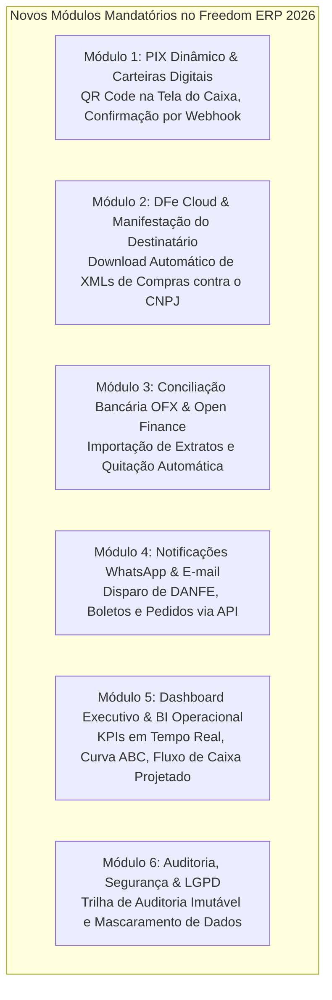

# Matriz de Decisão: Módulos a Serem Removidos vs. Incluídos

Este documento estabelece taxativamente quais módulos e tecnologias legadas do Freedom ERP **devem ser expurgados** do projeto e quais novos módulos e recursos comerciais **devem ser incorporados** para transformar o sistema em um produto comercial pronto para o mercado moderno de 2026.

---

## 1. Módulos e Componentes que DEVEM SER REMOVIDOS

A remoção destes componentes é indispensável para eliminar vulnerabilidades de segurança, incompatibilidades com sistemas operacionais modernos e tecnologias que se tornaram juridicamente ou tecnicamente obsoletas.

| Módulo / Componente Legado | Motivo Mandatório da Remoção | Solução de Substituição |
| :--- | :--- | :--- |
| **`freedom-ecf`** (Impressoras Fiscais Físicas ECF) | **Obsolescência Legal e Técnica**: As impressoras térmicas com memória fiscal (Bematech MP-20, Daruma FS-345, Elgin, Sweda) foram descontinuadas em todo o território nacional, substituídas pela NFC-e (modelo 65) e SAT-CF-e. Manter código de portas seriais RS-232 antigas gera débitos de manutenção desnecessários. | Módulo moderno de emissão de **NFC-e** com impressão térmica direta em bobina comum via spooler padrão do SO. |
| **TEF Discado / Arquivo Texto Legado** | **Insegurança e Fim de Suporte**: Integrações TEF antigas via troca de arquivos texto em `C:\TEF_DIAL` não atendem aos padrões PCI-DSS atuais e exigências bancárias. | Integração com **TEF IP Moderno** (Sitef / D-TEF via API REST/DLL 64-bit) e **PIX Direto na Maquininha**. |
| **`freedom-pool` (TopLink Essentials)** | **Tecnologia Descontinuada**: Implementação de pool de conexões do TopLink de 2005 (GlassFish v1), sem suporte a timeouts modernos, leak detection ou compatibilidade com Java 25. | **HikariCP** (padrão ouro mundial em pool JDBC, com tempos de aquisição sub-milissegundo). |
| **UDFs Firebird em C (`ib_udf`, `fbudf`)** | **Incompatibilidade Arquitetural**: Funções C compiladas para 32-bit de 2004 não rodam em ambientes de nuvem modernos de 64-bit e amarram o sistema ao Firebird legado. | Funções nativas e rotinas em **PL/pgSQL no PostgreSQL 16+**. |
| **Bibliotecas Legadas em `lib/`**: Log4j 1.x, Spring 2.5, Castor XML, Axis 1.x | **Vulnerabilidades Graves de Segurança (CVEs)**: O Log4j 1.x e Axis 1.x possuem vulnerabilidades críticas conhecidas e estão sem atualizações há mais de 10 anos. | Stack moderna: **SLF4J + Logback**, **Spring Framework 6+ / Jakarta Core**, **Jackson Databind**. |
| **Look and Feels Obsoletos (LiquidLnF, Metouia, Squareness)** | **Incompatibilidade Visual e HiDPI**: Falhas graves de renderização em telas 4K/FullHD, ausência de suporte a Dark Mode e visual dos anos 2000. | **FlatLaf** (Light, Dark, Windows 11 e macOS themes). |

---

## 2. Módulos e Recursos que DEVEM SER INCLUÍDOS

Estes módulos são obrigatórios para que o Freedom ERP se torne um produto comercial completo e competitivo no mercado corporativo atual:

### 2.1. Detalhamento dos Novos Módulos

#### Módulo 1: PIX Dinâmico & Carteiras Digitais
* Geração instantânea de QR Code dinâmico na tela do PDV e no fechamento do pedido.
* O sistema aguarda a notificação via Webhook da instituição financeira (Banco do Brasil, Inter, Itaú, EFI/Gerencianet).
* Identificação automática da quitação em menos de 3 segundos, liberando a emissão do cupom fiscal NFC-e sem digitação manual de valores pelo operador.

#### Módulo 2: Distribuição de DF-e & Importação Automática de Compras
* Consulta periódica automática no Web Service de Distribuição de DF-e da SEFAZ Nacional.
* O sistema detecta todas as NF-e emitidas por terceiros contra o CNPJ da empresa.
* Manifestação do Destinatário com 1 clique (Confirmação da Operação / Desconhecimento).
* Download do XML completo da nota de compra e importação automatizada:
  * Cadastramento automático de produtos novos não existentes.
  * Vinculação de fornecedor.
  * Atualização imediata do estoque com conversão de unidades (ex: compra em caixa com 12 e vende em unidade).
  * Atualização do Custo Médio Ponderado e lançamento das parcelas no Contas a Pagar.

#### Módulo 3: Conciliação Bancária OFX & Open Finance
* Importação de arquivos extrato no padrão internacional `.OFX` de qualquer banco.
* Mecanismo de conciliação com algoritmo inteligente (reconhecimento por valor, data e documento).
* Opção de conciliação direta via APIs de Open Finance dos principais bancos brasileiros.

#### Módulo 4: Comunicação Omnichannel (WhatsApp & E-mail)
* Disparo automático de mensagens via API oficial do WhatsApp Business / Provedores Cloud (Z-API, Evolution, Twilio):
  * Envio de DANFE em PDF e chave de acesso para o cliente assim que a venda é aprovada.
  * Envio de Boletos e código copia-e-cola de PIX antes do vencimento para combate à inadimplência.
  * Alertas de cobrança amigável para títulos vencidos.

#### Módulo 5: Dashboard Executivo & Gestão Visual
* Painel inicial analítico com cartões de indicadores (ModernCards):
  * Vendas do Dia / Mês comparadas com meta.
  * Inadimplência atualizada.
  * Saldo consolidado de contas bancárias.
  * Alerta de produtos com estoque abaixo do ponto de reposição.
  * Gráficos dinâmicos de faturamento dos últimos 12 meses e curva ABC de clientes e produtos.

#### Módulo 6: Módulo LGPD & Segurança Reforçada
* Gestão de consentimento de dados para clientes cadastrados.
* Ferramenta de anonimização de dados pessoais a pedido do titular.
* Trilha de auditoria detalhada que grava: `Quem alterou`, `Quando`, `Qual tabela/campo`, `Valor Anterior` e `Novo Valor`.

