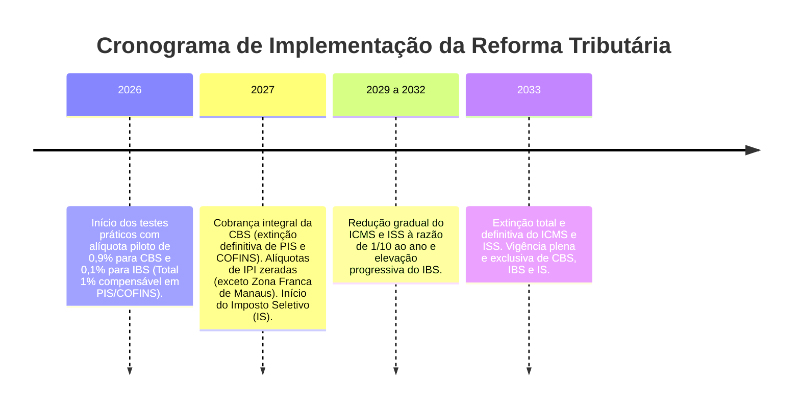

# Legislação Tributária e Fiscal Brasileira (Marco 2026+)

Este documento é a especificação canônica de regras fiscais do Freedom ERP. Todas as regras, fórmulas de cálculo e comportamentos descritos aqui são obrigatórios e **não deixam margem para interpretações ambíguas**.

---

## 1. O Marco de 2026: A Reforma Tributária sobre o Consumo (EC 132/2023)

A Emenda Constitucional nº 132/2023 instituiu o novo modelo tributário brasileiro, que unifica cinco tributos (PIS, COFINS, IPI, ICMS e ISS) em dois tributos sobre o valor agregado (IVA Dual) e um tributo regulatório:
* **CBS (Contribuição sobre Bens e Serviços)**: Competência Federal.
* **IBS (Imposto sobre Bens e Serviços)**: Competência compartilhada entre Estados, Distrito Federal e Municípios.
* **IS (Imposto Seletivo)**: Competência Federal sobre produtos nocivos à saúde e ao meio ambiente.

### 1.1. Cronograma de Transição Obrigatório



### 1.2. O Período de Transição 2026 (Sistema Híbrido Obrigatório)
Durante o ano de 2026, as empresas continuarão apurando e recolhendo o **ICMS, ISS, PIS e COFINS normalmente**, porém os documentos fiscais (NF-e modelo 55 e NFC-e modelo 65) já deverão destacar:
* **Alíquota da CBS**: 0,9% sobre o valor da operação.
* **Alíquota do IBS**: 0,1% sobre o valor da operação.
* **Compensação**: O valor de 1% apurado de CBS + IBS é deduzido diretamente da base/valor a recolher de PIS e COFINS da empresa no período.

---

## 2. Fórmulas de Cálculo e Estrutura Tributária

### 2.1. Cálculo do ICMS Próprio (Regime Normal)
$$Base_{ICMS} = Valor\_Produtos + Frete + Seguro + Outras\_Despesas - Desconto\_Incondicional$$
$$Valor_{ICMS} = Base_{ICMS} \times \left(\frac{Aliquota_{ICMS}}{100}\right)$$

### 2.2. Cálculo do ICMS-ST (Substituição Tributária)
O ICMS-ST garante o recolhimento antecipado do imposto sobre a cadeia de circulação:
$$Base_{ICMS-ST} = (Base_{ICMS} + Valor_{IPI}) \times \left(1 + \frac{MVA}{100}\right)$$
$$Valor_{ICMS-ST} = \left[Base_{ICMS-ST} \times \left(\frac{Aliquota\_Interna_{Destino}}{100}\right)\right] - Valor_{ICMS\_Proprio}$$
*Onde $MVA$ é a Margem de Valor Agregado original ou ajustada conforme o protocolo/convênio ICMS entre os estados.*

### 2.3. Cálculo do DIFAL (Diferencial de Alíquota - EC 87/2015)
Aplicável nas operações interestaduais destinadas a consumidor final não-contribuinte do ICMS:
$$DIFAL = Base_{ICMS} \times \left(\frac{Aliquota\_Interna_{Destino} - Aliquota\_Interestadual}{100}\right)$$
*Nos casos de estados com Fundo de Combate à Pobreza (FCP), soma-se o percentual adicional (geralmente 1% a 2%) destinado integralmente ao estado de destino.*

### 2.4. Cálculo dos Novos Tributos da Reforma (CBS e IBS)
Diferente do ICMS atual (que é calculado "por dentro"), a CBS e o IBS adotam o **cálculo por fora** (padrão internacional de IVA):
$$Base_{CBS/IBS} = Valor\_Operacao - Desconto\_Incondicional$$
$$Valor_{CBS} = Base_{CBS/IBS} \times \left(\frac{Aliquota_{CBS}}{100}\right)$$
$$Valor_{IBS} = Base_{CBS/IBS} \times \left(\frac{Aliquota_{IBS}}{100}\right)$$

---

## 3. Cadastros Fiscais Mandatórios

### 3.1. Classificação Fiscal (CFOP - Código Fiscal de Operações e Prestações)
Toda movimentação no sistema exige um CFOP válido:
* **Entradas no Estado**: `1.102` (Compra para comercialização), `1.556` (Uso e consumo), `1.403` (Compra com ST).
* **Entradas Interestaduais**: `2.102`, `2.556`, `2.403`.
* **Saídas no Estado**: `5.102` (Venda de mercadoria), `5.405` (Venda com ST retido anteriormente), `5.929` (Lançamento de NFC-e anterior).
* **Saídas Interestaduais**: `6.102`, `6.108` (Venda a consumidor final não-contribuinte), `6.403`.

### 3.2. CST (Código de Situação Tributária) vs. CSOSN (Simples Nacional)
* **Regime Normal**:
  * CST ICMS: 2 dígitos (`00` - Tributada integralmente; `10` - Tributada com ST; `20` - Redução de base; `40` - Isenta; `41` - Não-tributada; `60` - Cobrado anteriormente por ST).
  * CST PIS/COFINS: `01` (Tributável com alíquota básica), `04` (Monofásica), `06` (Alíquota zero), `07` (Operação isenta da contribuição).
* **Simples Nacional**:
  * CSOSN: `101` (Permite crédito de ICMS), `102` (Sem permissão de crédito), `500` (ICMS cobrado anteriormente por ST), `900` (Outros).

### 3.3. NCM (Nomenclatura Comum do Mercosul) e CEST
* O NCM deve possuir exatamente **8 dígitos**. O sistema não deve permitir o faturamento ou emissão de notas para itens com NCM zerado, incompleto ou inexistente na tabela oficial da Receita Federal.
* Para qualquer produto com CST `10`, `30`, `60`, `70` ou CSOSN `201`, `202`, `203`, `500`, a digitação do código **CEST** (7 dígitos) é **obrigatória**, sob pena de rejeição imediata da SEFAZ (`Rejeição 806: Operação com ICMS-ST sem informação do CEST`).

---

## 4. Lei da Transparência Fiscal (IBPT - Lei 12.741/2012)

Todo cupom NFC-e ou DANFE de NF-e emitido deve calcular e exibir no campo de informações complementares:
```text
Trib aprox: R$ 14,20 Federal, R$ 18,50 Estadual e R$ 0,00 Municipal. Fonte: IBPT/empresometro.com.br chave X1Y2Z3.
```
* O sistema deve possuir rotina de atualização automática ou manual da tabela do IBPT importando o arquivo `.csv` oficial ou consultando via API.

---

## 5. Proteção de Dados (LGPD - Lei 13.709/2018)

1. **Retenção Fiscal vs. Direito ao Esquecimento**:
   * O Código Tributário Nacional (art. 173) e a legislação contábil exigem a guarda dos documentos fiscais e livros contábeis pelo prazo prescricional de **5 anos mais o ano corrente**.
   * Quando um titular de dados exigir a exclusão de seus dados pessoais sob a LGPD:
     * O sistema deve **anonimizar** dados de prospecção, marketing e CRM (`nome`, `telefone`, `e-mail`).
     * As notas fiscais emitidas no passado **NÃO PODEM SER ALTERADAS OU APAGADAS**, mantendo-se os registros estritamente arquivados para atendimento à autoridade tributária sob a base legal de *Cumprimento de Obrigação Legal ou Regulatória* (art. 7º, II da LGPD).
2. **Logs de Acesso e Auditoria**:
   * O sistema deve registrar o ID do usuário, data/hora e IP de quem realizou exportações massivas de relatórios de clientes ou listagens com CPF.

