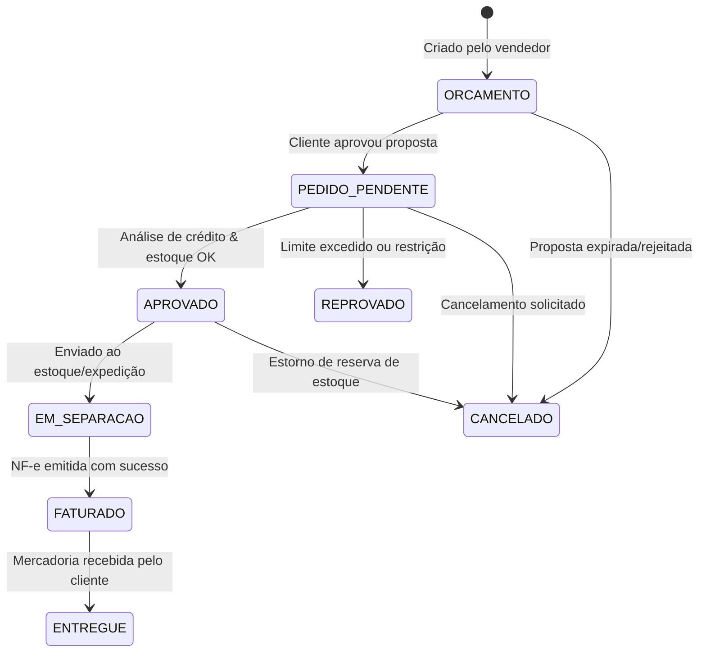

# Caderno de Regras de Negócio e Lógica Operacional por Módulo

Este documento detalha o funcionamento funcional, regras de validação estritas, fluxos de dados e lógica interna de cada módulo do **Freedom ERP**.

---

## 1. Módulo STD (Standard — Cadastros Centrais & Vendas)

### 1.1. Cadastro de Clientes e Fornecedores (Entidade Pessoa)
* **Validação de Documento Único (CPF / CNPJ)**:
  * Não é permitido cadastrar dois registros ativos com o mesmo número de CPF ou CNPJ dentro da mesma empresa (`codemp`).
  * O algoritmo de validação de dígitos verificadores de CPF (módulo 11) e CNPJ é executado antes de qualquer tentativa de persistência.
* **Consulta Automática via BrasilAPI**:
  * Ao digitar o CNPJ, o sistema dispara requisição HTTP assíncrona para a BrasilAPI. Havendo retorno de sucesso, preenche automaticamente: Razão Social, Nome Fantasia, Logradouro, Bairro, CEP, Cidade, UF e CNAE Principal.
* **Bloqueio de Inadimplência**:
  * Se o cliente possuir qualquer título em aberto vencido há mais de $N$ dias (parâmetro `DIAS_TOLERANCIA_INADIMP`, padrão 5 dias), o sistema bloqueia automaticamente a emissão de novos pedidos faturados a prazo, permitindo apenas vendas à vista (dinheiro ou PIX).

### 1.2. Pedidos de Venda e Orçamentos
* **Fluxo de Estados do Pedido**:

* **Reserva de Estoque**:
  * No momento em que o pedido passa para o status `APROVADO`, o sistema incrementa o campo `saldo_reservado` do produto e decrementa o `saldo_disponivel`:
    $$Saldo\_Disponivel = Saldo\_Fisico - Saldo\_Reservado$$
  * Se $Saldo\_Disponivel < Quantidade\_Solicitada$, a aprovação é barrada exigindo liberação de supervisor ou geração de Ordem de Produção / Requisição de Compra.

---

## 2. Módulo FNC (Financeiro)

### 2.1. Contas a Receber (`financeiro_conta_receber`)
* **Geração Automática a partir de Vendas**:
  * Ao faturar um Pedido de Venda com condição de pagamento a prazo (ex: 30/60/90 dias), o sistema gera automaticamente $N$ parcelas vinculadas, dividindo o valor total da nota pelos prazos definidos.
* **Cálculo de Juros e Multas por Atraso**:
  * Para pagamentos após a data de vencimento:
    $$Multa = Valor\_Parcela \times \left(\frac{Percentual\_Multa}{100}\right)$$
    $$Juros = Valor\_Parcela \times \left(\frac{Taxa\_Juros\_Mensal}{100 \times 30}\right) \times Dias\_Atraso$$
    $$Valor\_Cobrado = Valor\_Parcela + Multa + Juros - Desconto$$
* **Baixa Parcial e Quitação**:
  * Se o cliente pagar valor inferior ao saldo da parcela:
    * Gera-se um registro de baixa com a data do pagamento.
    * O saldo devedor da parcela é atualizado. O status permanece `PARCIALMENTE_PAGO`.
  * Se o cliente pagar o saldo total: status vai para `QUITADO`.

### 2.2. Conciliação Bancária
* **Importação OFX / Extratos**:
  * O sistema lê o bloco `<STMTTRN>` do XML/OFX contendo: data da transação (`<DTPOSTED>`), valor (`<TRNAMT>`) e identificador (`<FITID>`).
  * Realiza casamento automático com movimentações financeiras já lançadas com mesmo valor e data $\pm 2$ dias úteis.

---

## 3. Módulo GMS (Gestão de Materiais, Estoque & Compras)

### 3.1. Controle de Movimentação e Kardex
* **Princípio da Imutabilidade de Movimento**:
  * Uma movimentação de estoque gravada no banco de dados **NUNCA pode ser excluída fisicamente**.
  * Qualquer correção deve ser realizada por meio de um movimento de estorno com tipo oposto (se foi entrada, estorna com saída).
* **Custo Médio Ponderado (CMP)**:
  * Calculado exclusivamente nas entradas por compra de mercadorias.
  * Movimentações de saída, transferência entre almoxarifados ou devoluções de venda não alteram o custo médio unitário do produto.

### 3.2. Controle de Lotes e Validades
* Cada entrada de mercadoria perecível ou controlada exige a informação de:
  * Número do Lote (String).
  * Data de Fabricação.
  * Data de Validade.
* **Política PEPS / FIFO (Primeiro que Entra, Primeiro que Sai)**:
  * O sistema sugere automaticamente o lote com data de validade mais próxima no momento do faturamento ou separação.
  * Bloqueio imediato de venda para lotes com validade vencida.

---

## 4. Módulo PCP (Planejamento e Controle de Produção)

### 4.1. Estrutura de Produtos (BOM - Bill of Materials)
* Um produto acabado pode conter múltiplos componentes e matérias-primas organizados em níveis hierárquicos:
  * Nível 0: Produto Acabado.
  * Nível 1: Subconjuntos.
  * Nível 2: Matérias-Primas brutas.
* Cada item da estrutura possui coeficiente técnico de consumo e percentual de perda tolerada.

### 4.2. Ciclo da Ordem de Produção (OP)
1. **Geração da OP**: Informa produto acabado, quantidade a produzir e data prevista de entrega.
2. **Liberação**: O sistema empenha as matérias-primas no estoque (reserva física).
3. **Apontamento de Produção**: O operador registra as horas trabalhadas por posto de trabalho e as quantidades reais de insumos consumidas.
4. **Encerramento da OP**:
   * Dá baixa automática e definitiva nas matérias-primas consumidas.
   * Dá entrada no saldo físico do produto acabado no almoxarifado de expedição.
   * Calcula o custo real de produção:
     $$Custo\_Real = \sum Insumos\_Consumidos + \sum Mao\_de\_Obra + \sum Custos\_Indiretos\_Fabricacao$$

---

## 5. Módulo PDV (Ponto de Venda / Varejo)

### 5.1. Controle Rígido de Turno de Caixa
* **Abertura de Caixa**:
  * Operador informa o valor de fundo de troco (suprimento inicial).
  * O sistema gera um registro de turno (`pdv_turno_caixa`) com status `ABERTO`, registrando data/hora, operador e estação de trabalho.
* **Operações de Caixa**:
  * **Sangria**: Saída de dinheiro para cofre central quando o caixa atinge o valor limite de segurança.
  * **Suprimento**: Entrada adicional de numerário para troco.
* **Fechamento Cego de Caixa**:
  * O operador conta fisicamente os valores na gaveta (dinheiro, comprovantes de cartão, cheques) e digita os totais apurados sem que o sistema exiba o valor esperado pelo sistema.
  * O sistema calcula a diferença:
    $$Quebra\_de\_Caixa = Valor\_Informado - Valor\_Esperado$$
  * Registra se houve sobra ou falta de caixa e emite o relatório gerencial de fechamento.

