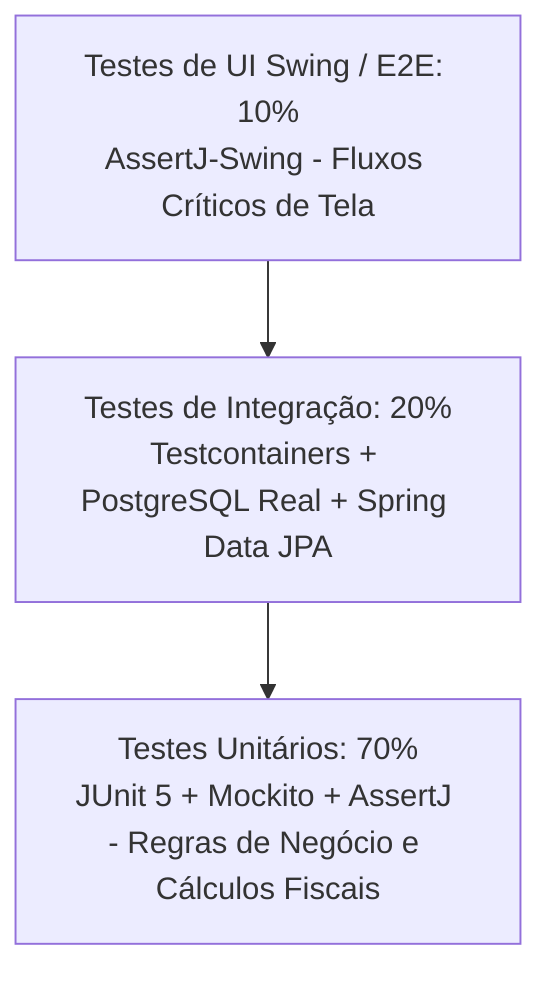

# Engenharia de Qualidade, TDD & Guardrails Arquiteturais

Este documento define os padrões rigorosos de garantia de qualidade, testes automatizados e guardrails arquiteturais do **Freedom ERP**.

---

## 1. Pirâmide de Testes e Estratégia de Qualidade



### Metas de Cobertura de Código:
* **Camada de Domínio e Serviços (`core-service`, `core-domain`)**: Mínimo de **80% de cobertura de linhas e branches** via JaCoCo.
* **Cálculos Fiscais e Juros Financeiros**: **100% de cobertura de branches** obrigatória. O build quebra caso haja falha ou branch não coberta em rotinas tributárias.

---

## 2. Guardrails Arquiteturais Estritos (ArchUnit)

Para assegurar que nenhum desenvolvedor viole as camadas arquiteturais, o projeto inclui testes do **ArchUnit** executados no `mvn test`:

```java
package org.freedom.guardrails;

import com.tngtech.archunit.core.importer.ImportOption;
import com.tngtech.archunit.junit.AnalyzeClasses;
import com.tngtech.archunit.junit.ArchTest;
import com.tngtech.archunit.lang.ArchRule;

import static com.tngtech.archunit.lang.syntax.ArchRuleDefinition.classes;
import static com.tngtech.archunit.lang.syntax.ArchRuleDefinition.noClasses;

@AnalyzeClasses(packages = "org.freedom", importOptions = ImportOption.DoNotIncludeTests.class)
public class ArchitectureGuardrailsTest {

    // Regra 1: A camada visual Swing NUNCA pode acessar classes JDBC ou de Persistência diretamente
    @ArchTest
    public static final ArchRule ui_must_not_access_database_directly =
        noClasses().that().resideInAPackage("..view..")
            .or().resideInAPackage("..ui..")
            .should().dependOnClassesThat().resideInAnyPackage(
                "java.sql..",
                "javax.sql..",
                "jakarta.persistence..",
                "org.hibernate.."
            )
            .because("A interface gráfica deve se comunicar apenas com Serviços via DTOs/Records");

    // Regra 2: A camada de Domínio deve ser pura e não conhecer componentes Swing
    @ArchTest
    public static final ArchRule domain_must_not_depend_on_ui =
        noClasses().that().resideInAPackage("..domain..")
            .should().dependOnClassesThat().resideInAnyPackage(
                "java.awt..",
                "javax.swing..",
                "com.formdev.flatlaf.."
            )
            .because("Entidades de domínio corporativo não podem ter acoplamento com a biblioteca gráfica");

    // Regra 3: Nomenclatura de Services
    @ArchTest
    public static final ArchRule services_must_be_named_properly =
        classes().that().resideInAPackage("..service..")
            .and().areNotAnonymousClasses()
            .should().haveSimpleNameEndingWith("Service")
            .orShould().haveSimpleNameEndingWith("ServiceImpl");
}
```

---

## 3. Testes de Integração com Testcontainers (PostgreSQL Real)

Em vez de bancos em memória com comportamento divergente (como H2), os testes de integração sobem um container Docker real do PostgreSQL 16:

```java
@Testcontainers
@SpringBootTest
public class ClienteRepositoryIntegrationTest {

    @Container
    public static PostgreSQLContainer<?> postgres = new PostgreSQLContainer<>("postgres:16-alpine")
            .withDatabaseName("freedom_test")
            .withUsername("test_user")
            .withPassword("test_pass");

    @DynamicPropertySource
    static void configureProperties(DynamicPropertyRegistry registry) {
        registry.add("spring.datasource.url", postgres::getJdbcUrl);
        registry.add("spring.datasource.username", postgres::getUsername);
        registry.add("spring.datasource.password", postgres::getPassword);
    }

    @Autowired
    private ClienteRepository clienteRepository;

    @Test
    @DisplayName("Deve persistir cliente e recuperar com busca trigram sem erros")
    void deveSalvarERecuperarCliente() {
        var cliente = new Cliente("Empresa Exemplo LTDA", "12345678000199");
        var salvo = clienteRepository.save(cliente);

        assertThat(salvo.getId()).isNotNull();
        assertThat(clienteRepository.findByCpfCnpj("12345678000199")).isPresent();
    }
}
```

