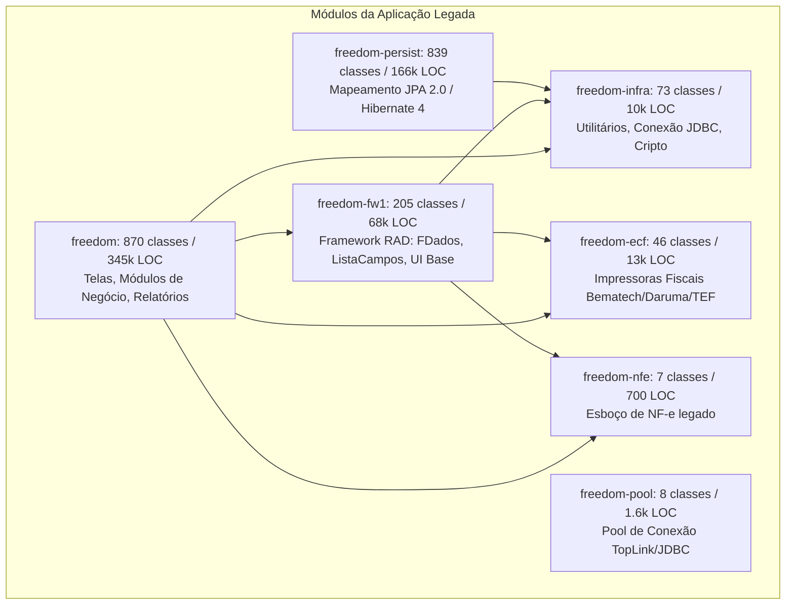
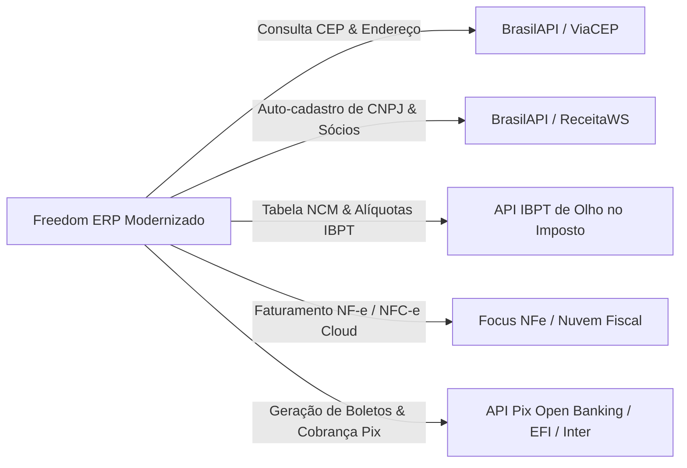
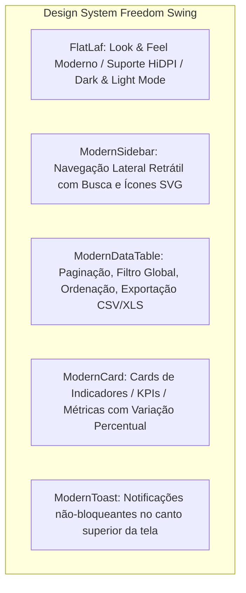
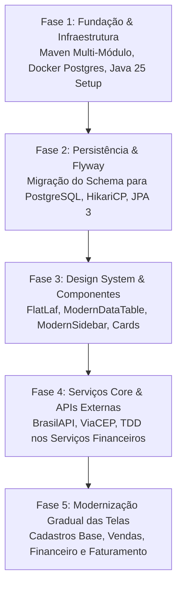

# Relatório Completo de Análise Técnica e Plano de Modernização
## Freedom ERP — Diagnóstico Profundo & Blueprint de Arquitetura (To-Be)

---

## 1. Sumário Executivo & Diagnóstico Geral

O **Freedom ERP** é um sistema de gestão empresarial maduro, de porte enterprise, concebido originalmente no final dos anos 1990 e mantido até meados de 2013 pela Setpoint Informática sob licença GPL/LGPL. Trata-se de uma aplicação **Java Desktop (Swing)** clássica de 2 camadas (*Client-Server* e *Rich Client*), cobrindo praticamente todos os domínios corporativos: Finanças, Vendas, Faturamento, Compras, Estoque, PCP, Livros Fiscais, CRM e Ponto de Venda.

### Métricas Gerais do Código-Fonte Atual (As-Is)

| Métrica | Valor Auditado | Observação |
| :--- | :--- | :--- |
| **Total de Classes Java** | **2.048 arquivos** | Base de código massiva e consolidada |
| **Linhas de Código (LOC)** | **~605.538 linhas** | Alta densidade de regras de negócio em tela |
| **Versão Java Alvo Atual** | **Java 1.5 / 1.6** (2007) | Falta genéricos em coleções, sem `try-with-resources` |
| **Banco de Dados Atual** | **Firebird 1.5 / 2.5** | Dialeto legado, dependência de UDFs em C e `generators` |
| **Build System Atual** | Eclipse IDE + JARs manuais em `lib/` | Ausência de Maven/Gradle, centenas de MB de binários no git |
| **Cobertura de Testes** | **< 0.5% (Inexistente)** | Menos de 15 testes soltos sem framework automatizado |
| **Interface Gráfica** | **Java Swing (Null Layout)** | Coordenadas absolutas em pixels (`adicCampo(x, y, w, h)`) |
| **Look and Feel** | LiquidLnF, Metouia, Squareness | Visuais dos anos 2000 incompatíveis com telas HiDPI/4K |

---

## 2. Inventário e Análise Detalhada dos Módulos



### 2.1. `freedom` (Aplicação Principal — 870 classes, 345.441 LOC)
É o núcleo operacional do ERP. Cada submódulo de negócio possui classes executáveis e telas especializadas:
* **`std` (Standard / Cadastros Base e Vendas)**: Clientes (`FCliente.java` com 4.986 linhas!), Fornecedores, Produtos, Vendedores, Pedidos de Venda, Orçamentos.
* **`fnc` (Financeiro)**: Contas a pagar, contas a receber, extratos, conciliação, boletos e plano de contas.
* **`gms` (Gestão de Materiais e Suprimentos)**: Estoque, controle de lotes, almoxarifado, custo médio e compras.
* **`pcp` (Planejamento e Controle de Produção)**: Estruturas de produtos (BOM), ordens de produção (OP), roteiros e fases.
* **`lvf` (Livros Fiscais)**: Apuração fiscal, regras de tributação (CFOP, CST, alíquotas).
* **`crm` / `atd`**: Atendimentos, chamados de suporte, contatos, agenda e pós-venda.
* **`pdv`**: Ponto de venda para varejo.
* **`rep`**: Gerador de relatórios via JasperReports / iReport legado.

### 2.2. `freedom-fw1` (Framework RAD Interno — 205 classes, 68.092 LOC)
* Motor de abstração de telas: `Aplicativo`, `FPrincipal`, `FFilho`, `FDados`, `FDetalhe`, `FTabDados`.
* Motor de persistência dinâmica: `ListaCampos` e `GuardaCampo`. Esse motor cria queries SQL dinâmicas concatenadas e as envia via `PreparedStatement`.
* Gerenciamento de componentes de interface: `JTextFieldPad`, `JTextFieldFK` (Lookup com chave estrangeira), `JTablePad`, `JTabbedPanePad`.
* **Débito técnico principal**: Alto acoplamento entre camada de apresentação e banco de dados; telas criam SQLs e gerenciam transações diretamente.

### 2.3. `freedom-persist` (Iniciativa JPA/Hibernate — 839 classes, 166.221 LOC)
* Mapeamento quase completo de todo o banco de dados em entidades JPA com Hibernate 4.1.0 e JPA 2.0 (`hibernate.cfg.xml` com mais de 300 entidades declaradas).
* **Grande oportunidade de ouro**: Toda a modelagem relacional de tabelas, chaves primárias e relacionamentos já foi transcrita em código Java, servindo como base imediata para modernização com Jakarta Persistence 3.x e Hibernate 6.6+.

### 2.4. `freedom-infra` e `freedom-pool` (Infraestrutura e Conexões)
* Contém conexão direta `DbConnection`, criptografia customizada, leitura de `.ini`, manipulação de datas e reflexão.
* `freedom-pool` implementa pooling manual baseado em TopLink Essentials (tecnologia de 2005 da Sun/Oracle). Hoje deve ser 100% substituído por **HikariCP**.

### 2.5. `freedom-ecf` e `freedom-nfe` (Hardware e Fiscal)
* `freedom-ecf`: Suporte a impressoras fiscais seriais (ECF RS-232: Bematech MP-20, Daruma FS-345) e TEF legado via DLL/Socket. Hoje essas impressoras estão praticamente extintas no Brasil, substituídas por NFC-e e SAT.
* `freedom-nfe`: Arquitetura rudimentar de comunicação com SEFAZ anterior às atualizações do layout 4.0 da NF-e.

---

## 3. Matriz de Débitos Técnicos vs. Soluções Modernas

| Área | Estado Atual (As-Is) | Arquitetura Alvo (To-Be) | Ganho Técnico & Negócio |
| :--- | :--- | :--- | :--- |
| **Java Runtime** | Java 1.5 / 1.6 (Raw Types, Vector, `Date`) | **Java 25 LTS** (Virtual Threads, Records, Pattern Matching) | Desempenho 4x superior, zero travamentos de UI na EDT |
| **Gerenciador de Dependências** | Pastas `lib/` com centenas de JARs binários | **Maven Multi-Módulos** (POM pai, BOM, repositórios centrais) | Rastreabilidade, segurança contra CVEs, build automatizado |
| **Banco de Dados** | Firebird 1.5/2.5 com UDFs em C e generators | **PostgreSQL 16/17** (Sequences, JSONB, Schemas) | Escalabilidade, robustez, padrão de mercado, backup ágil |
| **Infraestrutura** | Instalação local manual via executáveis/scripts | **Docker & Docker Compose** (PostgreSQL + pgAdmin) | Deploy em 1 comando: `docker compose up -d` |
| **Persistência de Dados** | SQLs manuais em `ListaCampos` + Hibernate 4 | **JPA 3.2 / Hibernate 6.6+ / Spring Data JPA ou Repositories** | Queries tipadas, cache L2, auditoria automática |
| **Qualidade & Testes** | 0 testes unitários automatizados | **TDD com JUnit 5, AssertJ, Mockito e Testcontainers** | Regressão zero, confiabilidade em refatorações |
| **Design de Interface** | Coordenadas absolutas fixas em pixels | **FlatLaf (Light/Dark/Win11) + MigLayout + SVG** | UI responsiva, elegante, moderna, compatível com 4K |
| **Componentes de UI** | `JTablePad` básico e menus em barra clássicos | **ModernDataTable, ModernSidebar, KPI Cards** | Experiência de usuário profissional e contemporânea |
| **APIs Externas** | Consultas manuais ou web services antigos | **BrasilAPI / ViaCEP / Nuvem Fiscal / Focus NFe** | Redução de mais de 30.000 linhas de código legado |

---

## 4. Blueprint de Modernização Técnica

### 4.1. Maven Multi-Module Project Structure

A nova estrutura elimina dependências circulares e divide o ERP em responsabilidades bem delimitadas:

```
freedom-erp/
├── pom.xml                               # POM Pai (Java 25, Gerenciamento de Versões)
├── docker/
│   ├── docker-compose.yml                # PostgreSQL 16 + pgAdmin 4
│   └── postgres/
│       └── init/01-init-database.sql     # Script de inicialização do schema
├── freedom-bom/                          # Bill of Materials
├── freedom-core-domain/                  # Entidades JPA (Jakarta), Records, Enums, DTOs
├── freedom-core-service/                 # Regras de Negócio, Repositories, Serviços TDD
├── freedom-infra-db/                     # Migrações Flyway/Liquibase e Config HikariCP
├── freedom-infra-api/                    # Integração BrasilAPI, ViaCEP, APIs Fiscais/Pix
├── freedom-ui-components/                # FlatLaf, ModernDataTable, ModernSidebar, Cards
├── freedom-ui-app/                       # Aplicação Desktop Swing (MDI/Tabbed, Telas)
└── docs/                                 # Documentação Técnica, Specs e ADRs
```

### 4.2. Java 25: Explorando as Novas Capacidades

1. **Virtual Threads (Project Loom)**:
   A interface Swing roda na **Event Dispatch Thread (EDT)**. Consultas lentas ao banco ou chamadas a APIs nunca devem travar a tela. Com Java 25:
   ```java
   // Execução assíncrona ultra-leve sem travar o Swing EDT
   public void carregarDadosTabelaAsync(Long clienteId) {
       Thread.ofVirtual().start(() -> {
           var dados = clienteService.buscarHistoricoCompleto(clienteId);
           SwingUtilities.invokeLater(() -> dataTable.setData(dados));
       });
   }
   ```
2. **Records**:
   Substituição de centenas de classes de DTOs e beans mutáveis por Records imutáveis para transferências de dados e respostas de APIs.
3. **Pattern Matching & Switch Expressions**:
   Eliminação de blocos `if/else` gigantescos de cálculo fiscal e estados de documentos.
4. **API `java.time`**:
   Substituição total de `java.util.Date`, `java.sql.Date` e `Calendar` por `LocalDate`, `LocalDateTime` e `Instant`.

---

## 5. Migração de Banco de Dados: Firebird para PostgreSQL

### 5.1. Tabela Comparativa de Recursos de Banco

| Recurso | Firebird 1.5 / 2.5 (Atual) | PostgreSQL 16 / 17 (Alvo) |
| :--- | :--- | :--- |
| **Auto Incremento** | `CREATE GENERATOR` + Trigger com `GEN_ID()` | `BIGINT GENERATED ALWAYS AS IDENTITY` ou `SERIAL` |
| **Funções Externas (UDF)** | Arquivos `.so`/`.dll` em C (`IB_UDF_abs`, `addDay`) | Funções nativas (`abs()`, `data + INTERVAL '1 day'`) |
| **Booleano** | `CHAR(1) CHECK (IN ('S', 'N'))` | Tipo nativo `BOOLEAN` (`true`/`false`) |
| **Paginação** | `FIRST 10 SKIP 20` | `LIMIT 10 OFFSET 20` |
| **Busca Textual** | `CONTAINING` (case-insensitive) | `ILIKE` ou índices `Trigram` (`pg_trgm`) |
| **Campos de Observação** | `BLOB SUB_TYPE 1` | Tipo nativo `TEXT` |
| **Triggers** | Sintaxe específica PSQL Firebird | PL/pgSQL padrão ANSI |

### 5.2. Orquestração Docker (`docker-compose.yml`)

Permite subir o ambiente completo de desenvolvimento e produção com um único comando:

```yaml
services:
  freedom-db:
    image: postgres:16-alpine
    container_name: freedom-postgres
    restart: always
    environment:
      POSTGRES_DB: freedom_erp
      POSTGRES_USER: freedom_user
      POSTGRES_PASSWORD: freedom_secure_password
      PGDATA: /var/lib/postgresql/data/pgdata
    ports:
      - "5432:5432"
    volumes:
      - freedom_pgdata:/var/lib/postgresql/data
      - ./postgres/init:/docker-entrypoint-initdb.d
    healthcheck:
      test: ["CMD-SHELL", "pg_isready -U freedom_user -d freedom_erp"]
      interval: 10s
      timeout: 5s
      retries: 5

  freedom-pgadmin:
    image: dpage/pgadmin4:latest
    container_name: freedom-pgadmin
    restart: always
    environment:
      PGADMIN_DEFAULT_EMAIL: admin@freedom.local
      PGADMIN_DEFAULT_PASSWORD: admin_password
    ports:
      - "5050:80"
    depends_on:
      freedom-db:
        condition: service_healthy

volumes:
  freedom_pgdata:
```

---

## 6. Camada de Persistência: JPA & Hibernate 6.x

### Estratégia de Transição:
1. **Reaproveitamento dos Modelos de `freedom-persist`**:
   O módulo `freedom-persist` já possui centenas de classes mapeadas. Faremos o upgrade de `javax.persistence` para `jakarta.persistence` (Jakarta EE 10 / JPA 3.2).
2. **Eliminação do SQL Direto na Interface**:
   Desacoplar a classe `ListaCampos` da tela. A interface passa a se comunicar com `Services` e `Repositories`.
3. **Gerenciamento de Pool de Conexões**:
   Adoção do **HikariCP**, garantindo tempos de aquisição de conexão abaixo de 1 milissegundo.

---

## 7. Metodologia: TDD, SDD, Spec Kit & Guardrails

### 7.1. TDD (Test-Driven Development)
* Todas as novas regras tributárias, cálculos financeiros de juros/multas, conciliação e rateios devem ser desenvolvidos com TDD (Red $\rightarrow$ Green $\rightarrow$ Refactor).
* Utilização de **Testcontainers** para testes de integração reais contra um PostgreSQL efêmero via Docker.

### 7.2. SDD (Specification-Driven Development) & Spec Kit
* Criação de especificações formais de negócio antes da codificação (`specs/financeiro/calculo-juros.spec.md`, `specs/fiscal/regras-icms-st.spec.md`).
* Documentação de decisões de arquitetura via **ADRs** (*Architecture Decision Records*).

### 7.3. Guardrails de Arquitetura (ArchUnit)
Implementação de testes estáticos com **ArchUnit** para impedir violações arquiteturais no build:
* *Regra 1*: Nenhuma classe do pacote `view` pode instanciar `java.sql.Connection` ou `EntityManager`.
* *Regra 2*: Nenhuma regra fiscal pode residir em classes Swing.
* *Regra 3*: Entidades de domínio não devem conter dependências de pacotes de UI.

---

## 8. Integração com APIs Externas (Economia Massiva de Código)

A integração com APIs modernas eliminará mais de 30.000 linhas de código frágil e obsoleto:



1. **BrasilAPI / ViaCEP**:
   * Preenchimento automático de CEP, Rua, Bairro, Cidade e UF.
   * Auto-completar cadastros de clientes com apenas a digitação do CNPJ (Razão Social, Nome Fantasia, CNAE, Endereço e Quadro Societário).
2. **APIs Fiscais em Nuvem (Focus NFe / Nuvem Fiscal)**:
   * Emissão, assinatura de certificado A1, transmissão e impressão de DANFE em PDF com poucas linhas de JSON, dispensando o ecossistema complexo de certificados manuais locais e drivers de impressora ECF.
3. **Open Finance / APIs Pix**:
   * Substituição de arquivos remessa/retorno CNAB 240/400 manuais por conciliação instantânea via Pix e Webhooks.

---

## 9. Novo Padrão de Nomenclatura (Clean Code & Modern SQL)

### 9.1. Nomenclatura de Código Java

| Padrão Legado (As-Is) | Padrão Moderno (To-Be) | Motivo |
| :--- | :--- | :--- |
| `txtCodCli`, `txtNomeCli` | `txtCustomerId`, `txtCustomerName` ou `txtCodigoCliente`, `txtNomeCliente` | Clareza sem abreviações crípticas |
| `Sgusuario`, `Vdcliente`, `Fnreceber` | `Usuario`, `Cliente`, `ContaReceber` ou `User`, `Customer`, `ReceivableInvoice` | Padrão PascalCase limpo e sem prefixos de 2 letras |
| `vlrTot`, `dtEmis`, `qtdaFat` | `valorTotal`, `dataEmissao`, `quantidadeFaturada` | Legibilidade autodocumentável |
| `adicCampo(x, y, w, h, ...)` | `addFormField(Component, Constraints)` ou layout declarativo | Separação de geometria e lógica |

### 9.2. Nomenclatura de Banco de Dados (PostgreSQL)

| Padrão Legado Firebird (As-Is) | Padrão Moderno PostgreSQL (To-Be) |
| :--- | :--- |
| `VDCLIENTE` / `FNRECEBER` / `CPCOMPRA` | `vendas_cliente` / `financeiro_conta_receber` / `compras_pedido` |
| `CODCLI`, `RAZCLI`, `NOMECLI` | `cliente_id`, `razao_social`, `nome_fantasia` |
| `DTVENCITREC`, `VLRPAGOITREC` | `data_vencimento`, `valor_pago` |
| `CODEMP`, `CODFILIAL` | `empresa_id`, `filial_id` |

---

## 10. Design System & Componentes Personalizados (Java Swing Moderno)

A interface permanecerá em **Java Swing**, porém adotando o padrão estético de softwares modernos (como IntelliJ IDEA, DBeaver e JetBrains Fleet):



### 10.1. `ModernSidebar` (Barra Lateral Moderna)
* Menu retrátil com animação suave, categorizado por módulos com ícones SVG vetoriais.
* Campo de busca rápida no topo (atalho `Ctrl + K` / `Ctrl + F`) para abrir qualquer tela instantaneamente.
* Indicador de usuário logado, empresa/filial ativa e botão de alternância Light/Dark Mode.

### 10.2. `ModernDataTable` (Tabela Avançada)
* Tabela construída sobre `JTable` estilizada com FlatLaf:
  * Linhas zebradas elegantes com padding configurável.
  * Barra de ferramentas embutida: busca textual global com filtro instantâneo.
  * Paginação de dados sob demanda para suporte a milhões de registros.
  * Renderizadores especiais para Badges de status (Ex.: *Pendente* em amarelo, *Pago* em verde, *Cancelado* em vermelho).
  * Exportação com um clique para CSV, Excel e PDF.

### 10.3. `ModernCard` (Cards de KPIs e Dashboard)
* Painéis com cantos arredondados, bordas sutis e fundo contrastante.
* Título da métrica, valor em destaque (ex.: `R$ 145.280,00`), ícone temático e tag de variação (`+15% vs mês anterior`).
* Permite criar telas iniciais e painéis analíticos para gerentes e diretores.

---

## 11. Plano de Ação em Fases (Roadmap)



1. **Fase 1 — Fundação & Engenharia de Build**:
   * Criação do `pom.xml` pai e estrutura modular Maven.
   * Criação do ambiente Docker Compose (PostgreSQL 16).
   * Configuração de testes unitários com JUnit 5 e Testcontainers.
2. **Fase 2 — Migração de Banco & Persistência**:
   * Conversão dos scripts DDL do Firebird para PostgreSQL 16 (removendo UDFs e adotando Sequences).
   * Atualização das entidades do `freedom-persist` para Jakarta Persistence 3.2 e Hibernate 6.6+.
3. **Fase 3 — Design System Swing**:
   * Criação do módulo `freedom-ui-components`.
   * Implementação do `ModernSidebar`, `ModernDataTable`, `ModernCard` e integração do `FlatLaf`.
4. **Fase 4 — APIs e Regras de Negócio**:
   * Integração de clientes HTTP nativos para BrasilAPI e serviços fiscais.
   * Refatoração com TDD das regras financeiras e de faturamento.
5. **Fase 5 — Entrega de Telas Modernizadas**:
   * Refatoração prioritária das telas de maior uso: Clientes, Vendas, Contas a Pagar/Receber e Dashboard Principal.
